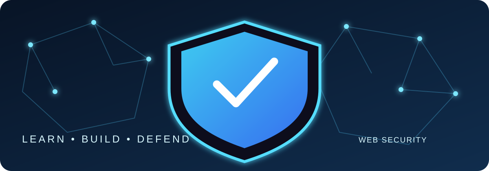
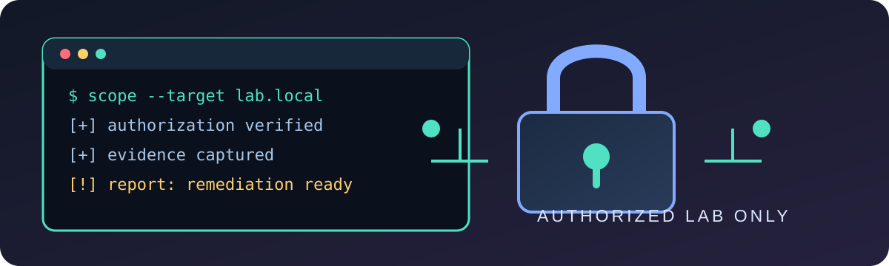

# WebSec Roadmap



**WebSec Roadmap** is a practical, checklist-driven path for learning networking, Linux, programming, web technologies, cybersecurity, and ethical web application penetration testing.

The repository is designed to help a learner move from first principles to hands-on security work without skipping the foundations that make security concepts easier to understand. Each roadmap is organized into phases, topics, practical exercises, projects, and readiness checks.

> **Use this material responsibly.** Only test systems, applications, networks, and accounts that you own or have explicit permission to assess. Practice in intentionally vulnerable labs and isolated environments.

## Table of contents

- [What this repository covers](#what-this-repository-covers)
- [Learning paths](#learning-paths)
- [Repository structure](#repository-structure)
- [Recommended order](#recommended-order)
- [How to use the roadmaps](#how-to-use-the-roadmaps)
- [Hands-on lab approach](#hands-on-lab-approach)
- [Ethical hacking principles](#ethical-hacking-principles)
- [Suggested study plan](#suggested-study-plan)
- [Progress tracking](#progress-tracking)
- [Projects and portfolio ideas](#projects-and-portfolio-ideas)
- [Useful resources](#useful-resources)
- [Contributing](#contributing)

## What this repository covers

The curriculum builds the knowledge required to understand and assess modern web systems:

1. **Programming:** Python syntax, data structures, functions, modules, file handling, and exceptions.
2. **Operating systems:** Linux commands, permissions, processes, services, shell scripting, SSH, and Linux security.
3. **Networking:** Models, addressing, subnetting, protocols, routing, DNS, HTTP(S), wireless, cloud networking, and network tools.
4. **Web technologies:** Browsers, HTML, CSS, JavaScript, HTTP, TLS, sessions, APIs, databases, backend systems, deployment, and web architecture.
5. **Cybersecurity:** Security principles, threats, vulnerabilities, risk, controls, identity, monitoring, incident response, and security frameworks.
6. **Web application testing:** OWASP concepts, Burp Suite, API testing, vulnerability validation, reporting, and deliberately vulnerable labs.

The goal is not to memorize tool commands. The goal is to understand **why a system behaves as it does**, identify where trust boundaries exist, validate security properties safely, and communicate findings clearly.

## Learning paths

### Start here

| Area | Roadmap | Focus |
| --- | --- | --- |
| Networking | [Networking roadmap](Networking/) | How devices communicate and how traffic moves |
| Linux | [Linux roadmap](Linux/) | The operating system and command-line skills used in security work |
| Python | [Python roadmap](python-rev/) | Automation, scripting, data processing, and tool development |
| Web fundamentals | [Web technologies roadmap](Roadmap/Web-technologies.md) | Browsers, HTTP, applications, APIs, databases, and deployment |
| Cybersecurity | [Cybersecurity roadmap](Roadmap/Cybersecurity.md) | Security concepts, controls, threats, risk, and defense |
| Git and GitHub | [Git and GitHub roadmap](Roadmap/Git-and-GitHub.md) | Version control, collaboration, and documentation |

### Continue into security testing

| Area | Roadmap | Focus |
| --- | --- | --- |
| Web application security | [Web application pentesting roadmap](Roadmap/web-application-pentesting.md) | Methodology, reconnaissance, OWASP vulnerabilities, testing, and reporting |
| Operating systems | [Operating system roadmap](Roadmap/Operating-System.md) | OS concepts that support privilege, process, and service analysis |
| Windows security | [Windows roadmap](Roadmap/Windows.md) | Windows administration and security foundations |



## Repository structure

```text
.
├── Linux/                 # Linux fundamentals, administration, networking, and security
├── Networking/            # Networking concepts, protocols, tools, and security
├── Roadmap/               # High-level cybersecurity, web, OS, and pentesting plans
├── python-rev/            # Python notes and exercises
├── assets/                # README illustrations
├── calculator.py          # Small Python practice project
└── README.md              # Repository guide
```

The folder names reflect the current learning material. Some notes use different capitalization or naming conventions because the content was added incrementally; links in this README point to the relevant locations.

## Recommended order

### Stage 1: Build the foundations

1. Learn basic computer and operating-system concepts.
2. Complete the early [Linux](Linux/) phases.
3. Study the [Networking](Networking/) phases through TCP/IP, DNS, HTTP(S), and network tools.
4. Practice Python fundamentals in [python-rev](python-rev/).
5. Learn Git and GitHub so notes, scripts, and reports are reproducible.

### Stage 2: Understand the web

1. Read the [Web technologies roadmap](Roadmap/Web-technologies.md).
2. Focus on browser behavior, the request-response cycle, HTTP methods, headers, cookies, sessions, and TLS.
3. Learn HTML, CSS, JavaScript, backend architecture, SQL, REST APIs, and common deployment patterns.
4. Use browser Developer Tools to inspect requests, responses, storage, and client-side behavior.

### Stage 3: Learn security concepts

1. Work through the [Cybersecurity roadmap](Roadmap/Cybersecurity.md).
2. Understand the CIA triad, AAA, threats, vulnerabilities, exploits, risk, security controls, IAM, and defense-in-depth.
3. Study OWASP, MITRE ATT&CK, CVE/CVSS, vulnerability management, logging, and incident response.
4. Practice threat modeling and secure design before attempting offensive testing.

### Stage 4: Practice ethical web testing

1. Follow the [Web application pentesting roadmap](Roadmap/web-application-pentesting.md).
2. Start with manual analysis and browser tools before relying on scanners.
3. Learn Burp Suite or OWASP ZAP in a controlled lab.
4. Test authentication, authorization, input handling, sessions, APIs, file uploads, and business logic.
5. Produce a clear report containing evidence, impact, severity, remediation, and retest status.

## How to use the roadmaps

Each checkbox represents a learning objective. A useful cycle is:

1. **Read:** Learn the concept from the roadmap and trusted documentation.
2. **Explain:** Write the idea in your own words and draw the relevant flow.
3. **Demonstrate:** Build or configure a small example in a local lab.
4. **Test:** Observe normal behavior, then test one controlled change.
5. **Document:** Record commands, screenshots, assumptions, results, and remediation.
6. **Review:** Return later and connect the topic to a real application or incident.

Do not treat a checked box as proof of mastery. Move on when you can explain the concept, recognize it in a system, and apply it safely.

## Hands-on lab approach

Use an isolated environment for experiments:

- A virtual machine or disposable container network.
- Deliberately vulnerable applications such as OWASP Juice Shop, WebGoat, or DVWA.
- Test accounts and synthetic data rather than personal or production data.
- Snapshots or version-controlled configuration so the environment can be reset.
- Network boundaries that prevent accidental access to external systems.
- A written scope describing allowed targets, tools, time window, and stop conditions.

For every exercise, capture:

| Record | Example |
| --- | --- |
| Objective | Verify whether an account can access another user's object |
| Scope | Local lab application and two test accounts |
| Expected behavior | The server returns `403` for unauthorized access |
| Evidence | Request, response, account context, and timestamp |
| Risk | Data exposure, privilege escalation, or service impact |
| Fix | Enforce server-side authorization on every object request |
| Retest | Repeat the same test after remediation |


## Ethical hacking principles

Ethical hacking is authorized security work intended to reduce risk. Follow these principles:

- **Authorization first:** obtain clear permission before scanning, intercepting, accessing, or modifying anything.
- **Stay in scope:** do not pivot to adjacent systems, accounts, domains, or data.
- **Minimize impact:** avoid destructive actions, denial of service, persistence, data extraction, or unnecessary automation.
- **Protect data:** collect the minimum evidence needed, redact secrets, and store reports securely.
- **Respect privacy:** never use real personal information when synthetic data will work.
- **Disclose responsibly:** report findings privately to the owner with enough detail to reproduce and fix them.
- **Be reproducible:** document the exact conditions, steps, evidence, limitations, and remediation.
- **Stop when uncertain:** pause if the authorization, target, or impact is unclear.

This repository is for education and defensive improvement. It is not a guide to unauthorized access, credential theft, malware deployment, evasion, or disruption.

## Suggested study plan

| Period | Main focus | Suggested outcome |
| --- | --- | --- |
| Weeks 1–2 | Linux and Python basics | Navigate systems, automate simple tasks, and explain basic OS behavior |
| Weeks 3–4 | Networking fundamentals | Read packet and protocol flows; explain DNS, TCP, HTTP, and TLS |
| Weeks 5–7 | Web technologies | Build a mental model of browsers, servers, APIs, sessions, and databases |
| Weeks 8–9 | Cybersecurity fundamentals | Classify threats, assess risk, and select appropriate controls |
| Weeks 10–12 | Web security testing | Complete safe labs and write professional vulnerability reports |
| Ongoing | Projects and review | Revisit weak areas and build increasingly realistic local applications |

Adjust the pace to your experience. Consistent practice and written notes are more valuable than rushing through every checkbox.

## Progress tracking

The roadmaps use Markdown checkboxes:

```markdown
- [ ] Topic to study
- [x] Topic completed and reviewed
```

When checking an item, consider linking a note, lab result, or project commit. Keep a separate lab journal for commands and evidence rather than placing secrets or sensitive output in this repository.

Useful completion milestones:

- Explain the difference between a threat, vulnerability, exploit, and risk.
- Read a raw HTTP request and response.
- Explain how cookies, sessions, authentication, and authorization work.
- Identify common OWASP risks and describe a safe remediation.
- Use a proxy only against an authorized lab target.
- Write a finding that another person can reproduce and fix.

## Projects and portfolio ideas

Build projects that demonstrate understanding instead of only tool usage:

1. **Secure login application:** password hashing, session expiration, MFA-ready design, and account lockout considerations.
2. **Role-based API:** server-side authorization, object ownership checks, validation, rate limiting, and audit logging.
3. **Threat model:** data-flow diagram, trust boundaries, abuse cases, risks, and mitigations for a small web application.
4. **Security headers lab:** compare insecure and secure configurations for CSP, HSTS, cookie flags, and framing protection.
5. **Vulnerability report portfolio:** document findings from a legal lab with reproduction steps, impact, severity, and remediation.
6. **Incident analysis:** examine supplied logs, identify indicators, build a timeline, and propose containment and recovery steps.

## Useful resources

- [OWASP Web Security Testing Guide](https://owasp.org/www-project-web-security-testing-guide/)
- [OWASP Top 10](https://owasp.org/www-project-top-ten/)
- [OWASP API Security Top 10](https://owasp.org/www-project-api-security/)
- [PortSwigger Web Security Academy](https://portswigger.net/web-security)
- [MDN Web Docs](https://developer.mozilla.org/en-US/)
- [MITRE ATT&CK](https://attack.mitre.org/)
- [NIST Cybersecurity Framework](https://www.nist.gov/cyberframework)
- [CVE.org](https://www.cve.org/)
- [Python documentation](https://docs.python.org/3/)
- [Linux man-pages](https://man7.org/linux/man-pages/)

## Contributing

Contributions that improve clarity, correctness, accessibility, and safe learning are welcome.

Before submitting a change:

- Keep topics focused and place them in the appropriate roadmap.
- Prefer reputable, stable references.
- Avoid instructions that enable unauthorized access or harm.
- Include safe lab assumptions for offensive-security examples.
- Use clear Markdown and preserve existing checklist formatting.
- Do not commit credentials, private data, large tool output, or exploit material targeting real systems.

## License and responsibility

Unless a separate license is added, treat the repository as learning material shared for personal and educational use. Check the repository owner's preferred license before redistributing or incorporating the content elsewhere.

The author and contributors are not responsible for misuse. You are responsible for obtaining permission, following applicable laws and policies, protecting data, and limiting all testing to authorized environments.
